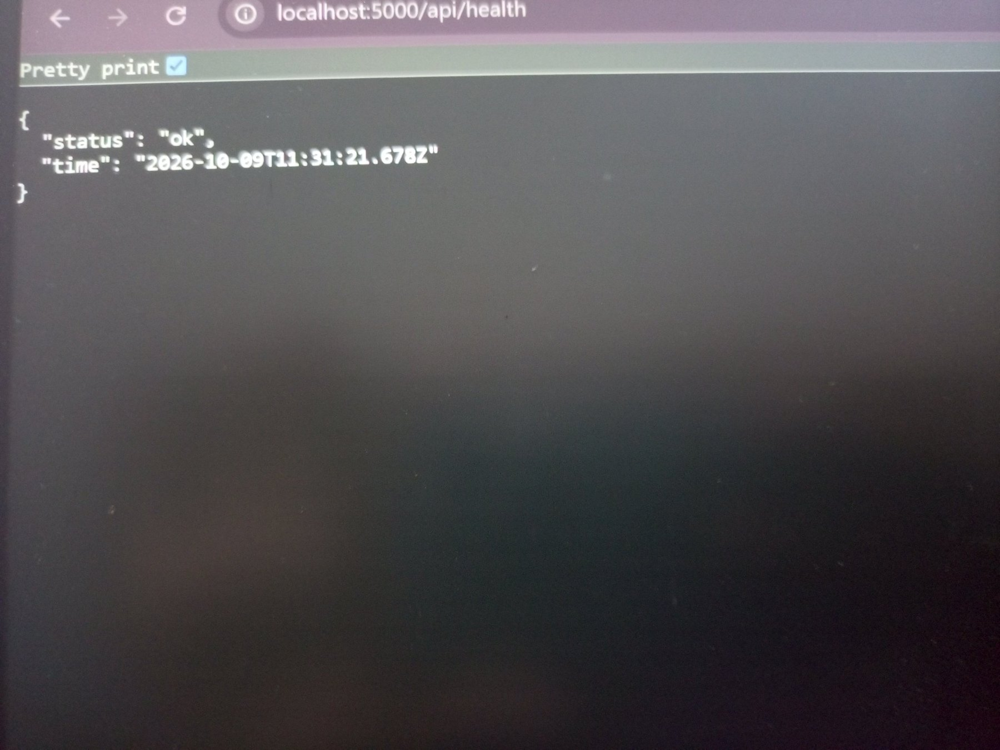
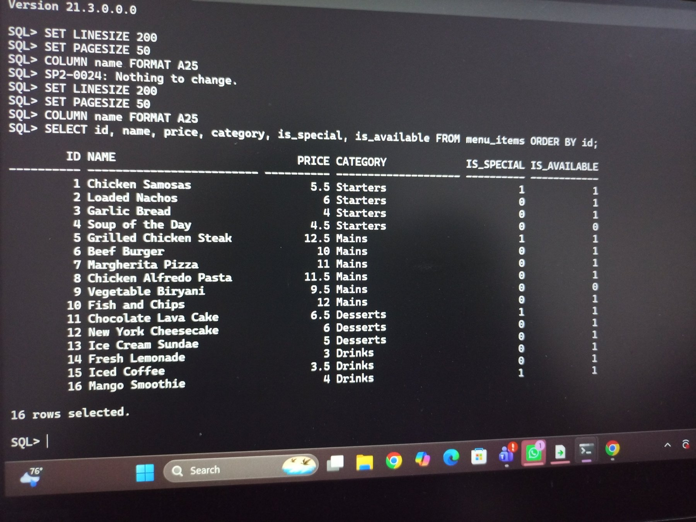
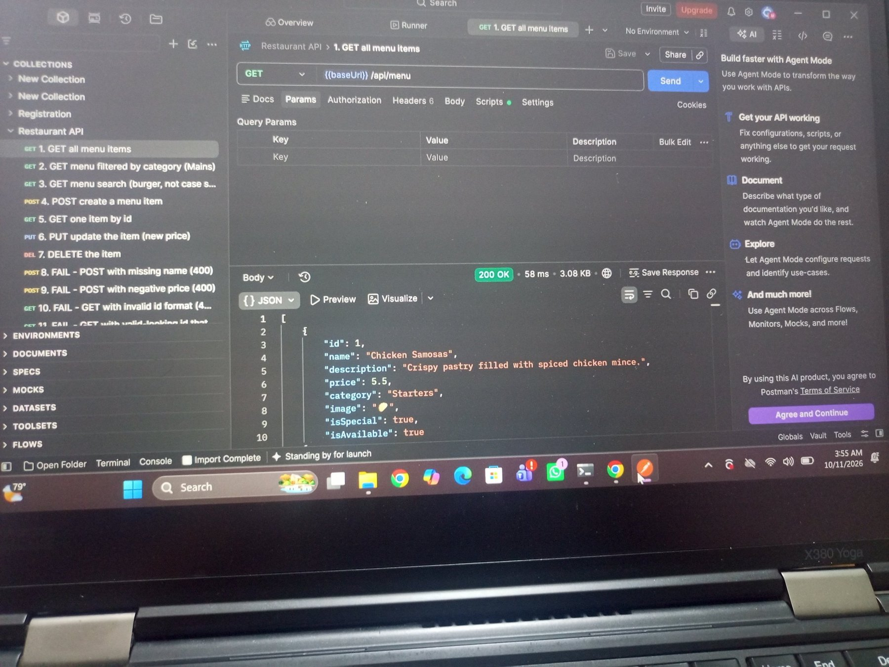
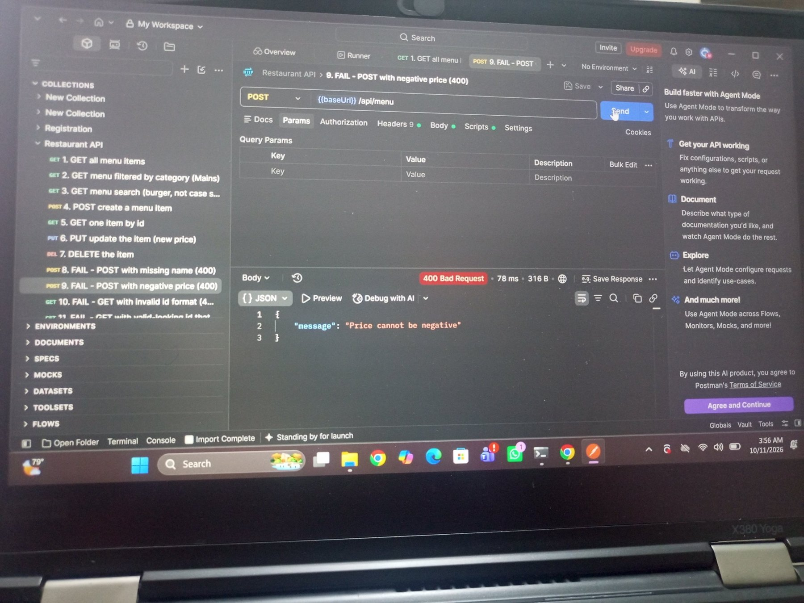
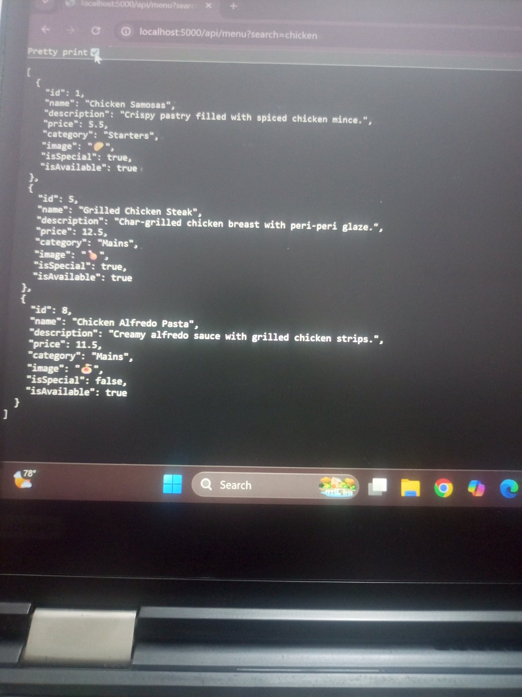
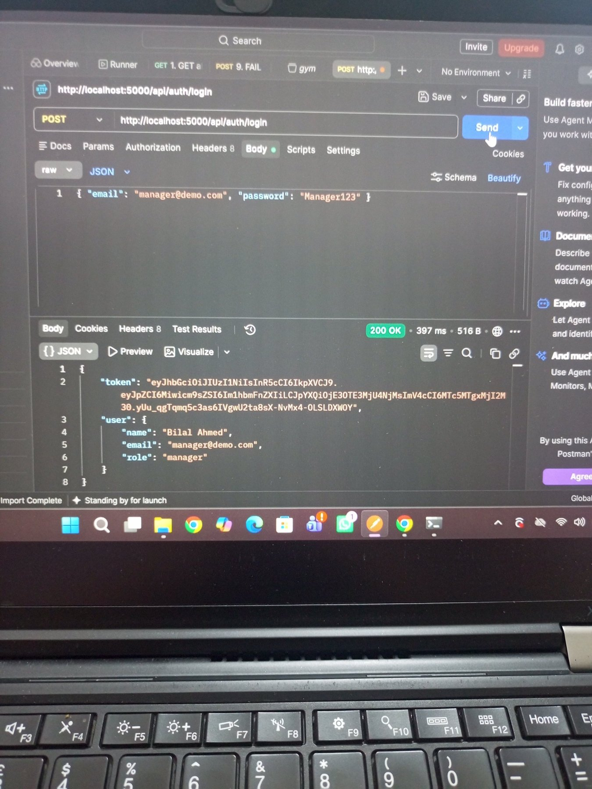

# Restaurant App (restaurant-app-mvp)

A restaurant ordering and table-booking app built with **React Native (Expo)**.
In **Assignment 1** the app ran on mock data stored inside each phone.
In **Assignment 2** a **Node.js + Express** server and an **Oracle database** were added, so every phone now reads and writes the same data.

> Database note: the assignment text says MongoDB. This project uses **Oracle Database 21c Express Edition** (the course allows any database). A MongoDB *collection* is an Oracle *table*, a *Mongoose model* is a table script plus a data-access file, and a *reference by id* is a *foreign key*.

## Features

- Register, login and logout. Passwords are hashed with bcrypt. JWT tokens (valid 1 day). The login is saved on the phone.
- Menu with category filter and search. The manager can add, edit, delete and switch availability.
- Orders: the server calculates the total from database prices and rejects unavailable items.
- Order tracking: the customer's app asks the server for the status every 10 seconds.
- Table reservations: the server checks that the table is free and has enough seats (409 if booked).
- Manager dashboard for menu, orders and reservations.

## Tech stack

| Part | Technology |
| --- | --- |
| App | React Native, Expo Go, AsyncStorage |
| Server | Node.js, Express, cors, dotenv, bcryptjs, jsonwebtoken |
| Database | Oracle Database 21c XE, `oracledb` driver |
| Testing | Postman |

## Project structure

```
restaurant-app-mvp/
├── src/                     React Native app (screens, context, hooks)
│   ├── api/client.js        BASE_URL and the request helper
│   └── hooks/useApi.js      data, loading, error, refetch
├── server/                  Backend
│   ├── config/db.js         Oracle connection
│   ├── models/              table scripts and data access
│   ├── routes/              URL -> controller mapping only
│   ├── controllers/         all database code
│   ├── middleware/auth.js   protect, managerOnly
│   ├── seed.js              fills the database with starting data
│   ├── server.js            Express app
│   └── .env.example         environment variable names (no real values)
├── A2/                      Assignment 2 submission files
│   ├── SRS_v2.pdf           updated SRS
│   ├── diagrams/            sequence and deployment diagrams
│   ├── screenshots/         test screenshots
│   └── restaurant-api.postman_collection.json
└── README.md
```

## Requirements

- Node.js (LTS) and npm
- Oracle Database 21c XE (or any Oracle 12.1 or newer; the `oracledb` Thin mode needs no Oracle Client)
- Expo Go on a phone, or an emulator
- Postman
- Phone and laptop on the **same Wi-Fi**

## How to run the server

```bash
cd server
npm install
```

1. **Create the `.env` file.** Copy `.env.example` to `.env` and fill in your values (Oracle user, password, connect string, `JWT_SECRET`). Never push `.env`.

   ```bash
   copy .env.example .env      # Windows cmd
   ```

2. **Create the tables and load the data.** Make sure Oracle is running, then:

   ```bash
   npm run seed
   ```

   This empties the tables and inserts the seed data (2 users, 16 menu items, 6 tables).

3. **Start the server.**

   ```bash
   npm run dev      # nodemon, restarts on changes
   # or
   npm start        # plain node
   ```

   You should see `Oracle connected` and `Server running on port 5000`.

4. **Check it.** Open `http://localhost:5000/api/health`. You should get `{"status":"ok","time":"..."}`.
   To open it on the phone, use the laptop's Wi-Fi IP, for example `http://192.168.18.28:5000/api/health`.

## How to run the app and where to change BASE_URL

The server address is set in **one place only**: `src/api/client.js`.

```js
export const BASE_URL = "http://192.168.1.15:5000";   // <- your laptop's Wi-Fi IPv4 address
```

Find the IP with `ipconfig` (use the **Wireless LAN adapter Wi-Fi** line, not a VirtualBox adapter).

| Where the app runs | Use |
| --- | --- |
| Real phone with Expo Go | `http://<laptop Wi-Fi IP>:5000` |
| Android emulator | `http://10.0.2.2:5000` |

Then start the app:

```bash
npm install
npx expo start
```

If the IP changes the next day, update `BASE_URL` and restart the app.

## Login details (seeded users)

| Role | Name | Email | Password |
| --- | --- | --- | --- |
| Manager | Bilal Ahmed | `manager@demo.com` | `Manager123` |
| Customer | TODO: name from seed.js | TODO: email from seed.js | TODO: password from seed.js |

These are demo accounts for testing only. In the database the passwords are stored as bcrypt hashes.

## API endpoints

Base URL: `http://<laptop IP>:5000`. Protected routes need the header `Authorization: Bearer <token>`.
Errors are returned as `{ "message": "..." }`.

| Method | Endpoint | Access | Request body | Response |
| --- | --- | --- | --- | --- |
| GET | `/api/health` | Public | None | `{ status, time }` |
| POST | `/api/auth/register` | Public | name, email, password | 201 token and user; 409 if email exists |
| POST | `/api/auth/login` | Public | email, password | token and user (name, email, role); 401 if wrong |
| GET | `/api/menu` | Public | None. Query: `category`, `search` | List of menu items |
| GET | `/api/menu/:id` | Public | None | One item; 400 bad id; 404 not found |
| POST | `/api/menu` | Manager | name, price, category (+ optional description, image, isSpecial, isAvailable) | 201 and the new item; 400 |
| PUT | `/api/menu/:id` | Manager | any item fields | Updated item; 400; 404 |
| DELETE | `/api/menu/:id` | Manager | None | Message; 404; 409 if used by an order |
| GET | `/api/tables` | Logged-in | None | List of tables with seats |
| POST | `/api/orders` | Logged-in | items `[{ menuItemId, quantity }]`, tableId?, note? | 201 order with server-calculated total; 400 if item unavailable |
| GET | `/api/orders/my` | Logged-in | None | The user's own orders |
| GET | `/api/orders` | Manager | None | All orders |
| PATCH | `/api/orders/:id/status` | Manager | status | Updated order; 400 if the change is not allowed |
| POST | `/api/reservations` | Logged-in | tableId, date, time, guests, notes? | 201; 400; 409 table already booked |
| GET | `/api/reservations/my` | Logged-in | None | The user's own reservations |
| GET | `/api/reservations` | Manager | None | All reservations |
| PATCH | `/api/reservations/:id` | Manager | status (Accepted or Declined) | Updated reservation; 400; 404 |

### Business rules (enforced by the server)

- The order total is calculated from database prices. The total sent by the app is ignored.
- Order status only goes forward: Pending, Preparing, Ready, Served. Cancelled is allowed only while Pending.
- A reservation is refused (409) if the table is already booked at that date and time, or has too few seats.

## Testing with Postman

Import `A2/restaurant-api.postman_collection.json` (Postman: Import, then Run). It has 12 menu requests; the last 5 are named `FAIL ...` and are expected to return 400 or 404.

## Screenshots

**Q2: Health route** (laptop browser)



> TODO (required by the assignment): add the Postman screenshot and the **phone browser** screenshot of `/api/health`.

**Q3: Oracle `menu_items` table after `npm run seed`** (16 rows)



**Q4: Menu API in Postman**

| Works (200 OK) | Fails as expected (400) |
| --- | --- |
|  |  |

Menu in the browser and search (`?search=chicken` returns 3 items):



**Q5: Login as manager** returns a token and the user with role `manager`:



> TODO (Q5): add the three authorization screenshots: no token (401), customer token (403), manager token (201).
> TODO (Q6): add screenshots from both devices showing the same new price.

All screenshots are in [`A2/screenshots/`](A2/screenshots).

## Video

> TODO: paste the link to the two-device test recording (maximum 4 minutes): `https://...`

## Documents

- [SRS_v2.pdf](A2/SRS_v2.pdf): updated requirements, database design, API endpoints and diagrams
- [Sequence diagram: customer places an order](A2/diagrams/sequence_place_order.png)
- [Deployment diagram](A2/diagrams/deployment.png)

## Common errors

| Error | What to check |
| --- | --- |
| Network request failed | Use the laptop's IP, not `localhost`. Same Wi-Fi on both devices. Server running. Windows Firewall allows port 5000. |
| `ORA-01017` invalid username/password | Check the Oracle user and password in `.env`. |
| `ORA-12541` / `ORA-12514` cannot connect | Oracle listener not running, or wrong service name in `ORACLE_CONNECT_STRING`. Run `lsnrctl status`. |
| `req.body` is undefined | `app.use(express.json())` must come before the routes. |
| CORS error | `app.use(cors())` in `server.js`. |
| 401 on every request | Header must be `Authorization: Bearer <token>` with one space. |
| Worked yesterday, not today | The laptop IP changed. Update `BASE_URL`. |

## Author

TODO: your name, roll number, course, Fall 2026.
